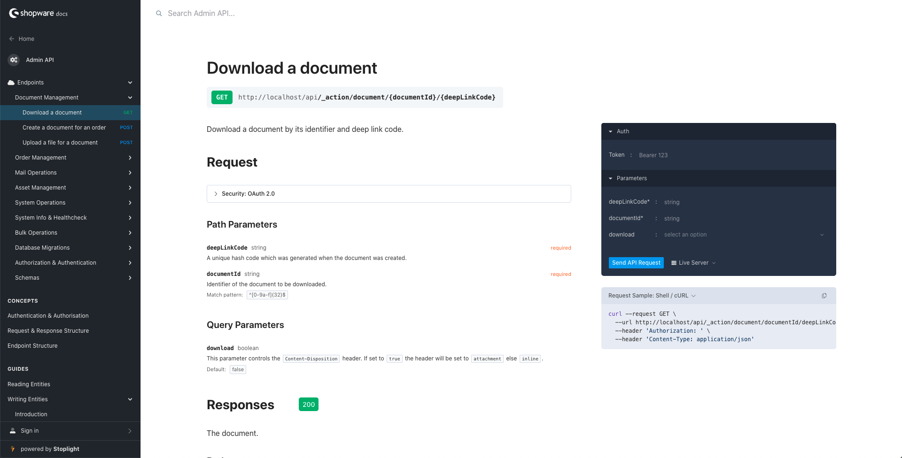

# Shopware 6 Admin API Reference

This repository reflects our official Admin API reference and documentation available on [shopware.stoplight.io/docs/admin-api](https://shopware.stoplight.io/docs/admin-api).



## Notes

The `adminapi.json` file contains the OpenAPI schema. Please do not make manual changes to that file, since it is synchronized with the latest version using an automated action. Feel free to propose changes to all other files in this repository.

## Version branches

Different branches (e.g. `trunk`, `latest`, `v6.6`) hold API schemas for different Shopware 6 versions. Workflows and docs are maintained on the default branch and can be synced into version branches by merging from main; generated schema JSON files on each branch are kept automatically. If you work with version branches, run once per clone: `git config merge.keepSchema.driver true`.

## Docs

*This repository is embedded into [nextgen-portal](https://github.com/shopware/nextgen-portal) under the [/resources/admin-api/](https://developer.shopware.com/admin-api/). This repository is also connected to the Shopware Dev Docs connector GitHub app which manages commit status checks in PRs and triggers production deployments.

### Development

1. Clone this repository

```
cd /www/
git clone git@github.com:shopware/admin-api-reference.git
cd admin-api-reference
```

2. Make sure you have your local copy of the nextgen-portal repository in the same parent directory.

```
pnpm docs:env
```

3. Link articles from your local copy of the release-notes into the nextgen-portal.

```
pnpm docs:link
```

4. Start the development server.

```
pnpm docs:preview
```
